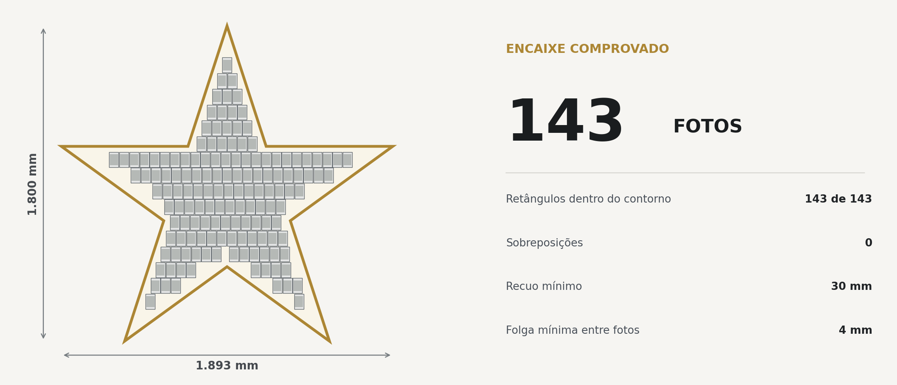

# A estrela comporta 143 fotos por face?

**Desafio Técnico — SAF Botafogo** · Estudo geométrico complementar ao slide **02/08**  
**Status:** encaixe matemático demonstrado; capacidade física e procedimento de colagem ainda sujeitos a protótipo e aceite de Operações.

A estrutura cenográfica de *A Estrela se Completa* foi projetada como um ativo reutilizável e com duas faces. Este documento sustenta a estimativa apresentada na proposta: **143 posições para fotografias Instax Mini em cada face**, dadas as premissas de contorno, dimensões e folgas especificadas abaixo. **Não confundir demonstração geométrica com homologação de produção.**

## Quanto cabe — e quanto o piloto pretende utilizar?

| Indicador | Valor | Interpretação |
|---|---:|---|
| Capacidade geométrica documentada — 1 face | **143** | 143 retângulos encaixados, sem sobreposição |
| Posições encontradas na busca inicial | **146** | Arranjo encontrado pelo algoritmo; 143 foram selecionadas e documentadas |
| Capacidade bilateral **condicional** | **286** | Duas faces com o mesmo padrão, se forem fisicamente acessíveis e homologadas |
| Piloto — 100 grupos da torcida + até 25 dos bastidores | **até 125 fotos na estrela** | Duas exposições por grupo: uma lembrança e uma para colagem |
| Preenchimento projetado **da face frontal** | **87,4%** | 125 ÷ 143, condicionado ao cumprimento das metas |

O piloto **não precisa preencher os 286 espaços**. Priorizar a face frontal permite uma composição quase completa, enquanto a segunda face funciona como capacidade de expansão futura — não como meta de atendimento.

## Memória dimensional

| Parâmetro | Premissa adotada | Natureza da informação |
|---|---|---|
| Altura útil da estrela | **1.800 mm**, excluindo a base | Hipótese do conceito a confirmar em CAD |
| Largura estimada | **1.892,6 mm** | Proporção de estrela regular de cinco pontas |
| Fotografia Instax Mini | **54 × 86 mm**, posição vertical | Medida oficial da fotografia completa, com moldura |
| Recuo do contorno externo | **≥ 30 mm** | Margem geométrica simulada |
| Distância entre cartões | **≥ 4 mm** | Folga mínima simulada, sensível ao posicionamento manual |
| Área geométrica de uma face | **1,1114 m²** | Modelo de estrela regular |
| Área externa dos 143 cartões | **0,6641 m²** | 143 × 0,054 × 0,086 m |

O cálculo utiliza a **dimensão total do cartão**, e não apenas a área fotográfica. A [Fujifilm Brasil](https://www.fujifilm.com/br/pt-br/consumer/instax/film) informa 54 × 86 mm para o filme Instax Mini e 46 × 62 mm para sua área de imagem.

## Demonstração geométrica

O arquivo `Botafogo_143_Posicoes_por_Face.csv` registra as coordenadas, em milímetros, de **cada uma das 143 posições**. A rotina reproduzível `validar_encaixe_143.py` verifica a inclusão dos retângulos no contorno, as interseções e as distâncias mínimas.

| Verificação executada | Resultado |
|---|---:|
| Fotografias integralmente dentro do polígono | **143 de 143** |
| Sobreposições identificadas | **0** |
| Menor distância observada até o contorno | **30,00 mm** |
| Menor separação observada entre cartões | **4,00 mm** |

**Limite da prova:** o algoritmo valida um contorno bidimensional idealizado. Não verifica espessura da estrutura, perfil de LED, fixações, resistência mecânica, estabilidade do suporte, adesivo removível ou conforto de quem cola. A existência de 143 retângulos possíveis também não implica facilidade de colagem espontânea.

## Sensibilidade do projeto

A busca geométrica original apresentou as seguintes configurações. **São arranjos encontrados, não máximos matemáticos demonstrados.**

| Hipótese alterada | Posições encontradas por face |
|---|---:|
| Estrela 1,80 m de altura, 1,893 m de largura; recuo 30 mm; folga 4 mm | **146** |
| Mesmas dimensões, folga de 5 mm | 141 |
| Mesmas dimensões, recuo de 35 mm | 135 |
| Mesmas dimensões, folga de 8 mm | 126 |
| Estrela de 1,70 m de altura útil, com mesma proporção | 123 |
| Estrela de 1,80 m de altura, mas largura limitada a 1,80 m | 132 |

O encaixe de 143 é **sensível a pequenas alterações**. Por isso, qualquer mudança nas dimensões, no perfil iluminado ou no espaçamento exige uma nova contagem, em vez de repetir automaticamente o número de 143.

## Condições para aprovação de produção

1. **Cenografia e Branding:** obter desenho CAD confirmando **1,80 m de altura útil da estrela, sem a base**, largura próxima de 1,89 m e área interna realmente disponível para colagem.
2. **Fornecedor e Operações:** subtrair do mapa os volumes e pontos ocupados por LED, fixações, presilhas, juntas e eventuais zonas interditadas.
3. **Branding e equipe de execução:** realizar teste físico com 143 cartões em tamanho real, adesivo removível e **colagem por pessoas não treinadas**; avaliar marcações discretas de posicionamento.
4. **Operações e fornecedor:** validar estabilidade e acesso ao verso antes de divulgar os **286 espaços** como capacidade operacional.

**Regra de decisão:** se o protótipo demonstrar menos de 143 posições com segurança e execução simples, a apresentação e o plano operacional deverão adotar **a quantidade efetivamente comprovada**.

## Defesa executiva para a banca

> A estimativa de 143 fotografias por face foi testada com as dimensões externas reais da Instax Mini. Construímos e verificamos um arranjo de 143 cartões dentro da estrela, sem sobreposição, respeitando 30 mm de recuo e 4 mm de folga. Isso demonstra a **viabilidade geométrica**, não a capacidade definitiva de uma peça pronta. O fornecedor e Operações precisam validar o CAD e o protótipo. No piloto, a meta de até 125 fotografias para colagem corresponde a cerca de 87% de uma face; o verso permanece como possibilidade de expansão.

## Fontes e arquivos

| Referência | Finalidade |
|---|---|
| [Fujifilm Brasil — Filme Instax Mini](https://www.fujifilm.com/br/pt-br/consumer/instax/film) | Medidas oficiais: 54 × 86 mm; área de imagem 46 × 62 mm |
| `Botafogo_143_Posicoes_por_Face.csv` | Coordenadas e medidas de cada fotografia |
| `validar_encaixe_143.py` | Validação reprodutível do encaixe e das distâncias |
| `Botafogo_143_encaixe_documental.png` | Visualização técnica do arranjo |
| `Botafogo_Defesa_Tecnica_143_por_Face.pdf` | Apresentação diagramada desta defesa |

**Escopo técnico:** o documento complementa o Slide 2 com uma prova geométrica bidimensional. Não substitui protótipo, projeto executivo ou aceite de Operações.
