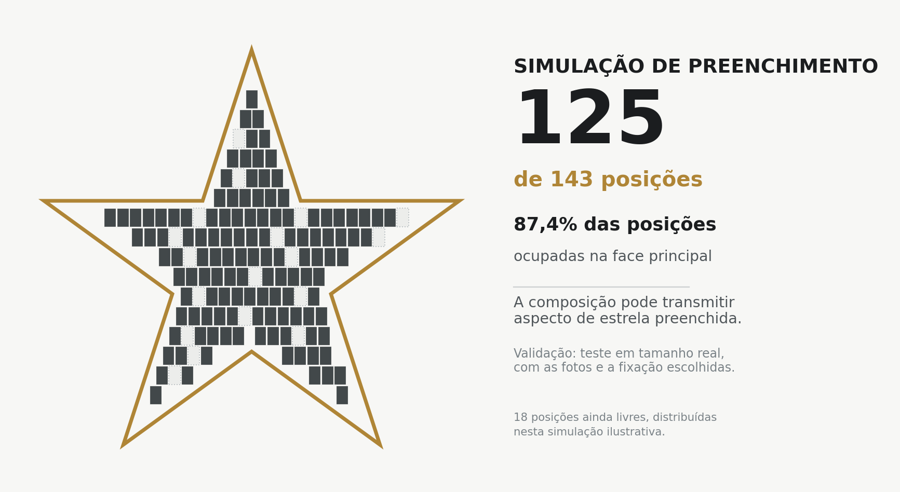
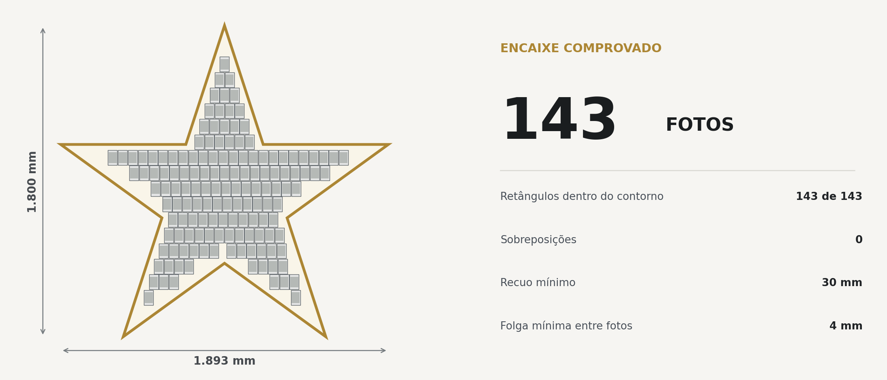

# Como 125 fotos podem fazer a estrela parecer cheia?

O modelo encaixa 143 fotografias Instax Mini por face de uma estrela regular com 1,80 m de altura útil. O piloto prevê até 125 colagens na face principal: 125 ÷ 143 = 87,4% das posições mapeadas.

O percentual mede posições ocupadas, não cobertura física do acrílico. A área externa dos 143 cartões corresponde a cerca de 59,7% da área do polígono modelado. Uma segunda face teria capacidade geométrica equivalente se fosse utilizável, mas não faz parte da meta inicial.

## Simulação de preenchimento

A distribuição mostra as 125 fotografias e as 18 posições restantes. É o recurso que usei para avaliar o equilíbrio visual entre braços e centro da estrela. O preenchimento visto na simulação ainda precisa ser confrontado com a estrutura real.

## Premissas dimensionais

| Parâmetro | Valor no modelo |
|---|---:|
| Altura útil da estrela (sem base) | 1.800 mm |
| Largura da estrela regular | 1.892,6 mm |
| Cartão Instax Mini completo, vertical | 54 × 86 mm |
| Recuo do contorno | ≥ 30 mm |
| Folga entre cartões | ≥ 4 mm |
| Área geométrica de uma face | 1,1114 m² |
| Área externa dos 143 cartões | 0,6641 m² |

A [Fujifilm Brasil](https://www.fujifilm.com/br/pt-br/consumer/instax/film) informa 54 × 86 mm para o cartão completo e 46 × 62 mm para a imagem. A modelagem usa a dimensão externa, com moldura.

## Demonstração geométrica

O CSV `Botafogo_143_Posicoes_por_Face.csv` contém as 143 coordenadas, em milímetros. O script `validar_encaixe_143.py` verifica inclusão, sobreposições e distâncias.

| Verificação executada | Resultado |
|---|---:|
| Fotografias integralmente dentro do polígono | 143 de 143 |
| Sobreposições identificadas | 0 |
| Menor distância observada até o contorno | 30,00 mm |
| Menor separação observada entre cartões | 4,00 mm |

A validação é bidimensional. Estrutura, fixação, eventuais perfis de iluminação e facilidade de colagem precisam ser avaliadas no protótipo.

## Por que documentar 143 posições?

O estudo passou por arranjos mais densos e por variações de tamanho e espaçamento. Mantive no resultado final o mapa de 143 cartões porque ele tem coordenadas individuais e um script capaz de verificar contorno, recuo e interseções. As outras explorações não integram a capacidade declarada: sem mapa verificável, não seriam uma prova equivalente.

Se as dimensões ou os acabamentos mudarem, o mapa deverá ser recalculado. A capacidade não é uma propriedade fixa de qualquer estrela de 1,80 m.

## Passagem ao protótipo

O protótipo deve receber um ensaio com 125 cartões, seguido de verificação do limite de 143. Acesso à face, fixação, base, acabamentos e participação do público podem reduzir a área útil. A decisão de produção será tomada com essa medição, não pela figura ilustrativa.

Evidências: [Fujifilm — Instax Mini](https://www.fujifilm.com/br/pt-br/consumer/instax/film), `Botafogo_143_Posicoes_por_Face.csv` e `validar_encaixe_143.py`.

[PDF deste README](README.pdf) · [Slide](assets/slide_02.png)
