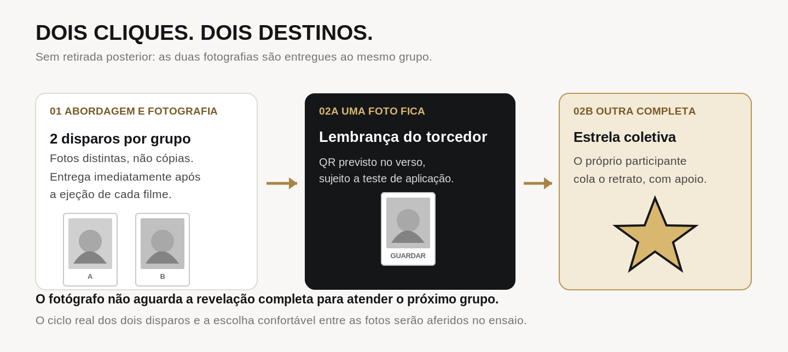
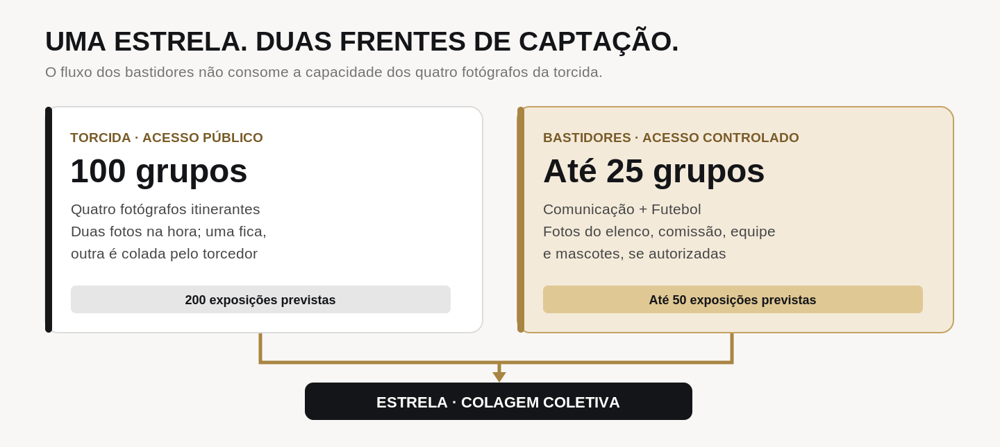

# Por que duas fotos instantâneas?

Escolhi dois disparos distintos porque a lembrança do torcedor não deve depender da fotografia que ficará exposta. Uma imagem é guardada pelo grupo; a outra, colada na estrela. Quatro fotógrafos percorrem a área de público, enquanto Comunicação organiza separadamente os registros dos bastidores, com Futebol.

## Jornada da fotografia

O fotógrafo convida o grupo, explica a ação, faz dois disparos e entrega as fotos após a ejeção. O participante escolhe uma para levar e encaminha a outra à estrela. Não há impressão remota nem senhas.

A Instax Mini 12 ejeta a foto imediatamente, mas a imagem leva cerca de 90 segundos para revelar. O fotógrafo não precisa aguardar ao lado do grupo; quem participa segue no percurso e escolhe o retrato quando ele estiver reconhecível. Como a caminhada estimada leva menos do que a revelação, o ensaio deve medir também o tempo de decisão e colagem (README 04).

## Equipamentos e filme

| Item | Especificação para cotação e ensaio |
|---|---|
| Câmeras | Quatro Instax Mini 12 ou equivalentes |
| Captação | Dois disparos distintos por grupo |
| Filme | Instax Mini compatível com a câmera; cartuchos de 10 exposições |
| Cartão | 54 × 86 mm; imagem de 46 × 62 mm |
| Manuseio | Pelas bordas, sem dobrar, sacudir ou comprimir durante a revelação |

A [Fujifilm](https://www.instax.com/mini_12/pt/spec/) informa as especificações da câmera e o tempo aproximado de revelação. Compatibilidade do filme, enquadramento e qualidade das fotos entram no ensaio; o custo das exposições consta no README 06.

## Torcida e bastidores

| Frente | Disparos previstos |
|---|---:|
| 100 grupos da torcida × 2 | 200 |
| Até 25 grupos dos bastidores × 2 | Até 50 |
| Testes, refações e perdas | 50 |
| Total de planejamento | 300 exposições (30 cartuchos) |

Comunicação faz os registros dos bastidores em janela acordada com Futebol e leva as fotos ao Leste. Futebol indica, conforme disponibilidade, um funcionário com trajetória representativa no clube para a colagem simbólica. Na frente de público, o próprio torcedor cola o retrato.

Número de exposições não é sinônimo de colagens concluídas. As contagens são registradas separadamente.

## QR na foto de lembrança

O QR aparece no verso da lembrança e no totem, mas não é condição para participar. A aplicação no filme em revelação é um ponto de teste: precisa preservar a fotografia e não criar uma etapa adicional no atendimento. Formulário e uso das respostas ficam detalhados no README 07.

## Ensaios de produção

| Frente | Verificação objetiva |
|---|---|
| Fotografia | Tempo de abordagem, dois disparos, entrega e nova abordagem; enquadramento e nitidez sob a iluminação prevista |
| Revelação | Imagem reconhecível, escolha e colagem sem pressão sobre o filme |
| QR | Leitura, adesão ao cartão e tempo extra de aplicação |
| Fixação | Adesivo removível, estabilidade e facilidade de colagem por torcedores |
| Bastidores | Acesso, autorização, transporte das fotos e gesto simbólico |
| Imagens | Informação ao público, uso físico e eventual divulgação tratados separadamente com Jurídico e Comunicação |

O [art. 14 da LGPD](https://www.planalto.gov.br/ccivil_03/_ato2015-2018/2018/lei/l13709.htm) e o [entendimento da ANPD](https://www.gov.br/anpd/pt-br/assuntos/noticias/anpd-divulga-enunciado-sobre-o-tratamento-de-dados-pessoais-de-criancas-e-adolescentes) orientam a análise específica para crianças e adolescentes. O procedimento de autorização e tratamento das imagens cabe às áreas responsáveis.

[PDF deste README](README.pdf) · [Slide](assets/slide_03.png)
