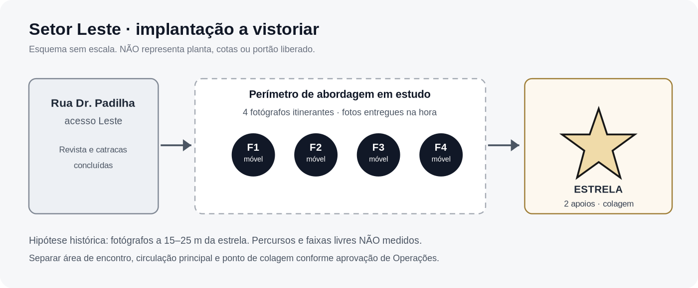

# Por que o Setor Leste?

Escolhi o Setor Leste pela combinação entre a procura histórica por ingressos e a possibilidade de manter fotografia e colagem em um percurso contínuo. Em [2017, o Botafogo](https://www.botafogo.com.br/noticias/por-dentro-do-setor-leste) registrou 10.511 pacotes de sócio-torcedor destinados ao setor. Em [agosto de 2026](https://www.fogaonet.com/noticias-do-botafogo/botafogo-fluminense-ingressos-esgotados-leste-superior-oeste-superior-b-desbloqueado/), o Leste Superior voltou a esgotar ingressos. Os dois registros reforçaram minha escolha de estudar esse acesso primeiro.

A proposta é concentrar a experiência após as catracas da Rua Doutor Padilha. Assim, o torcedor pode ser fotografado e seguir até a estrela sem precisar atravessar novamente a revista ou o controle de entrada.

## Onde a experiência acontece?

O [Botafogo identifica a Rua Doutor Padilha como acesso Leste](https://botafogo.com.br/nilton-santos-informacoes-tecnicas). Usei também o [projeto da LSFG Arquitetos](https://www.lsfgarquitetos.com/portfolio-collections/todos/engenhao) para compreender a distribuição dos acessos e a circulação do estádio. O ponto exato será definido em vistoria, considerando o espaço efetivamente disponível no dia da partida.

Nesse percurso, quatro fotógrafos identificados por mochilas-pirulito circulam entre os grupos, enquanto dois profissionais de apoio acompanham a colagem. A distribuição deve manter livres os corredores principais, as rotas acessíveis e as saídas.

## Distância e revelação

A distância inicial de 15–25 m entre abordagem e estrela é uma hipótese não medida. A câmera Instax Mini 12 ejeta a fotografia imediatamente; a revelação leva aproximadamente 90 s, com variação segundo temperatura e aparecimento progressivo da imagem.

A 0,8 m/s, um deslocamento simulado de 15–25 m dura 19–31 s. A fotografia pode chegar à estrela ainda em revelação; no ensaio, verificarei o reconhecimento da imagem, a escolha e a colagem, sem prolongar o trajeto nem pressionar o filme.

## Capacidade projetada

O piloto considera quatro fotógrafos, 100 minutos de atendimento e 75% de tempo produtivo:

`(4 × 100 min × 0,75) ÷ (3 min/grupo) = 100 grupos`

Os três minutos por grupo incluem convite, enquadramento, dois disparos e entrega; devem ser cronometrados em ensaio. A conta de 100 grupos exclui os bastidores, atendidos por Comunicação e Futebol.

## Condições para implantar

| Frente | Evidência necessária |
|---|---|
| Implantação | Planta cotada e vistoria para estrela, base e fotógrafos após as catracas, sem ocupar áreas de serviço ou emergência. |
| Circulação | Medição dos caminhos reais, inclusive acessíveis, e conferência dos cruzamentos de fluxo e rotas de fuga. |
| Atendimento | Ensaio dos ciclos dos quatro fotógrafos, chegada dos grupos e atuação dos dois apoios; recalcular a meta se necessário. |
| Liberação | Operações autoriza ponto, estrutura e circulação antes da abertura; sem aceite, a ativação não abre naquele local. |

Normas de consulta na implantação: NT 5-01 do CBMERJ e ABNT NBR 9050, conforme a pertinência técnica definida para o ponto escolhido.

[PDF deste README](README.pdf) · [Slide](assets/slide_04.png)

