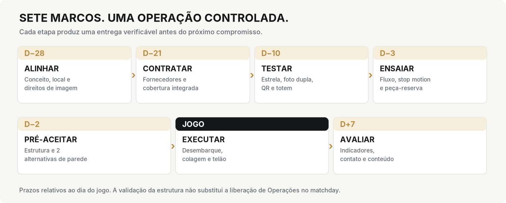

# Quem executa, valida e aprova?

Branding e Eventos coordena sete marcos, de D−28 a D+7, integrando Operações, Futebol, Comunicação, Comercial, Sócio-Torcedor e Jurídico. Cada área aprova as entregas de sua competência; Branding consolida o plano e acompanha os aceites.

## Como a ideia se transforma em operação?

Defini os marcos pelo que deve estar pronto antes de avançar, não apenas pela passagem dos dias. A principal diferença está entre o pré-aceite de D−2 e a liberação de abertura no estádio.

| Marco do projeto | Entrega planejada | O que precisa estar comprovado |
|---|---|---|
| D−28 · Alinhar | Conceito, vistoria e direitos de imagem | Briefing consolidado; local preferencial identificado para vistoria; regras preliminares de imagem e acesso encaminhadas às áreas competentes. |
| D−21 · Contratar | Fornecedores e cobertura integrada | Escopos, prazos, responsabilidades, critérios de aceite e alternativas contratualmente definidos; valores sujeitos à cotação. |
| D−10 · Testar | Estrela, dois disparos, QR e totem | Protótipos e ensaios documentados; falhas, correções e responsáveis identificados. |
| D−3 · Ensaiar | Fluxo completo, stop motion e peça-reserva | Simulação conjunta da jornada, da colagem e da entrega audiovisual; alternativa física testada. |
| D−2 · Pré-aceitar | Estrutura e duas alternativas de parede | Verificação técnica prevista para a montagem principal e para B/C, com evidências e aceite preliminar de Operações. |
| Jogo · Executar | Desembarque, colagem e telão | Equipe orientada, local novamente conferido, autorização do Futebol quando aplicável, cobertura e conteúdo prontos para operação. |
| D+7 · Avaliar | Indicadores, contato e conteúdo | Dados consolidados, incidentes registrados, tratamento autorizado das imagens e avaliação de aprendizados. |

D−2 não libera a operação ao público. A conferência final é no dia do jogo. Essa distinção evita que uma montagem aprovada no papel dispense a vistoria depois do transporte e da instalação.

## Áreas e decisões

| Área | Responsabilidade | Decisão ou aceite |
|---|---|---|
| Branding e Eventos | Conceito, contratações, coordenação e cronograma | Consolida escopo e evidências |
| Operações | Implantação, acesso, circulação e segurança | Libera estrutura, espaço e alternativas |
| Futebol | Elenco e representante dos bastidores | Confirma participantes e horários |
| Comunicação | Captação, edição, telão e publicações | Aprova conteúdo e produção editorial |
| Comercial | Contratos e eventual apoio de parceiros | Negocia obrigações e fornecedores |
| Sócio-Torcedor | Convites aos associados Camisa 7 | Valida canais e mensagens |
| Jurídico | Imagens, privacidade e instrumentos | Revisa autorizações e cláusulas |

## Entregas a contratar

| Frente | Entrega e teste de aceite |
|---|---|
| Cenografia | Projeto da estrela, base, transporte, montagem e teste de estabilidade |
| Fotografia | Quatro câmeras, filme compatível, 300 exposições previstas e ensaio de dois disparos |
| Identificação | Quatro mochilas-pirulito, ajuste e legibilidade na circulação |
| Totem e sinalização | Leitura do QR, materiais e posição autorizada |
| Equipe | Quatro fotógrafos, dois apoios, coordenação, escalas e treinamento |
| Audiovisual | Captação da colagem, arquivo do telão, teste e vídeo-reserva |
| Contingência | Materiais de parede, testes de aplicação/remoção e seguro conforme escopo |

O detalhamento das rubricas está no README 06. A matriz de acompanhamento do repositório 05 separa entrega, evidência e responsável pelo aceite de cada marco, sem preencher aprovações ainda não concedidas.

## Aceite e passagem de etapa

Branding organiza o fluxo de aceite, mas não assume a decisão técnica das outras áreas: Operações pode vetar a instalação; Futebol decide sobre acesso e participação; Comunicação e o operador audiovisual decidem se a peça pode ir ao telão. No cenário de atraso do fornecedor, essa divisão aparece no GO/NO-GO do README 08.

Referências: [CBMERJ — notas técnicas](https://www.cbmerj.rj.gov.br/notas-tecnicas/) e [Confea — ART](https://www.confea.org.br/servicos-prestados/anotacao-de-responsabilidade-tecnica-art), quando aplicáveis à instalação.

[PDF deste README](README.pdf) · [Slide](assets/slide_05.png)
