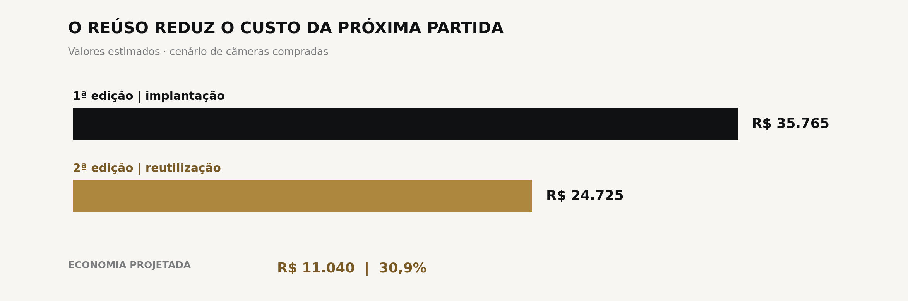
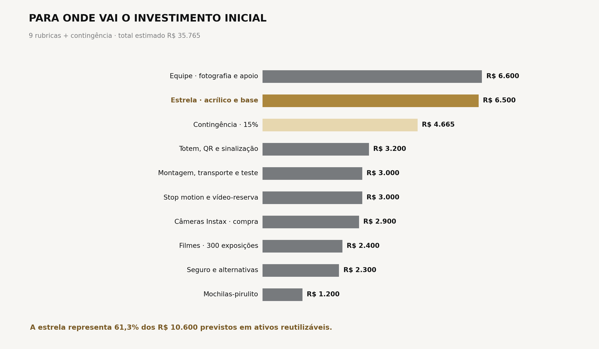

# Como o reúso reduz os custos?

O orçamento separa compra inicial de ativos, consumo e serviços recorrentes. A repetição equivalente reutiliza a estrela e, se compradas, as câmeras e mochilas.

## Quanto custa realizar — e repetir — a ativação?

A implantação compra R$ 10.600 em ativos: estrela (R$ 6.500), quatro câmeras (R$ 2.900) e mochilas (R$ 1.200). Na segunda edição, mantêm-se equipe e consumíveis, com R$ 1.000 para guarda, limpeza e conservação. Se houver aluguel das câmeras, o cenário deve ser recalculado.

| Memória de cálculo | Valor |
|---|---:|
| 1ª edição · R$ 31.100 + 15% de contingência | R$ 35.765 |
| 2ª edição · (R$ 31.100 − R$ 10.600 + R$ 1.000) × 1,15 | R$ 24.725 |
| Redução prevista por edição · R$ 35.765 − R$ 24.725 | R$ 11.040 (30,9%) |

## Composição do orçamento inicial

| Item | Valor |
|---|---:|
| Estrela de acrílico, base e acabamento nas duas faces | R$ 6.500 |
| Quatro câmeras instantâneas e acessórios | R$ 2.900 |
| Filmes instantâneos (300 exposições) | R$ 2.400 |
| Quatro mochilas-pirulito e identificação | R$ 1.200 |
| Fotografia: quatro fotógrafos, dois apoios e coordenação | R$ 6.600 |
| Totem, QR, sinalização e fixação | R$ 3.200 |
| Montagem, transporte, vistoria e ensaio | R$ 3.000 |
| Stop motion, edição e vídeo-reserva | R$ 3.000 |
| Seguro e soluções de contingência para a parede | R$ 2.300 |
| Subtotal | R$ 31.100 |
| Contingência (15%) | R$ 4.665 |
| Total da implantação | R$ 35.765 |

Planilhas: [rubricas](dados/orcamento.csv) e [equipe — hipótese de custos](dados/equipe_hipotese.csv). A distribuição ilustrativa dos R$ 6.600 de equipe prevê R$ 3.600 para fotógrafos, R$ 1.200 para apoios e R$ 1.800 para coordenação; não são cotações individuais.

A provisão para 300 exposições é de R$ 2.400, ou R$ 8 por foto. Esse preço unitário é uma premissa de planejamento, a confirmar na cotação dos filmes compatíveis. A R$ 10 por exposição, por exemplo, o acréscimo seria de R$ 600 na base e R$ 690 no total da implantação, com os 15% de contingência. O orçamento apresentado no slide permanece inalterado.

## Referências de mercado e metodologia

O orçamento foi construído a partir das necessidades da ativação, de consultas a preços públicos e da projeção dos serviços de produção. Estas referências orientam as rubricas correspondentes:

| Fornecedor / referência | Parâmetro utilizado |
|---|---|
| [Fujifilm — Instax Mini 12](https://loja.fujifilm.com.br/products/camera-instantanea-fujifilm-instax-mini-12-branca-marfim) e [filmes Instax](https://loja.fujifilm.com.br/collections/instax-mini) | Câmera a R$ 649 e conjunto de 40 exposições a R$ 206,90 nas consultas de referência; base para equipamentos e filmes. |
| [Backup Locadora — Fujifilm](https://backuplocadora.com.br/marca/fujifilm) | Referência de R$ 129 por diária da Instax Mini 12 com 10 fotos; utilizada para avaliar a alternativa de locação. |
| [FreelaAV — fotógrafo](https://www.freelaav.com.br/diarias/fotografo) | Mediana publicada de R$ 630 por diária; referência para dimensionamento da equipe. |
| [Fujiplas — chapa de acrílico](https://www.fujiplas.com.br/chapa-acrilico-cristal-2-00-x-1-00-x-3mm-2) | Referência de matéria-prima para o estudo da cenografia. A estrela completa inclui fabricação, base e acabamento. |

O efeito iluminado dos mockups é ilustrativo. Iluminação ou LED não têm rubrica separada: sua inclusão exige orçamento e especificação técnica adicionais.

Para fechar o orçamento, cotar a estrela completa, os filmes instantâneos compatíveis e a compra versus locação das câmeras. Valores estimados, sujeitos às cotações finais.

[PDF deste README](README.pdf) · [Slide](assets/slide_06.png)
