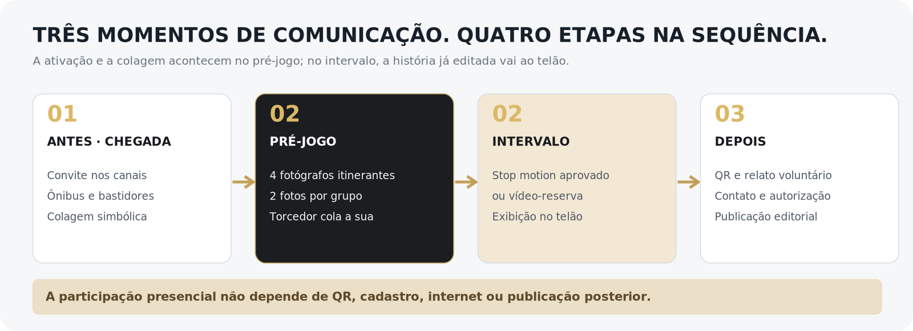
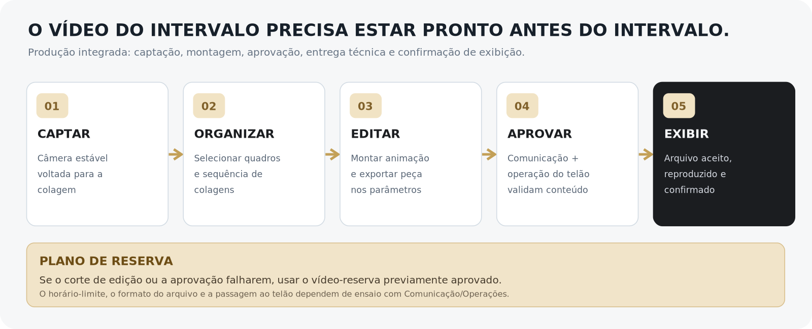

# Como a estrela chega ao telão?

O vídeo do intervalo não pode depender de uma edição concluída no último instante. Estruturei a comunicação como produção com prazo de corte: registrar a construção da estrela, montar a peça, submetê-la à aprovação e entregá-la ao operador do telão. Se essa cadeia não terminar a tempo, entra o vídeo-reserva.

## Quatro momentos

Na chegada, Comunicação registra os bastidores e, com Futebol, transfere os retratos ao Leste para o gesto simbólico. No pré-jogo, a torcida recebe os dois retratos e cola um deles. No intervalo, o telão exibe o registro da estrela ou a peça-reserva. Depois da partida, o clube pode publicar o conteúdo aprovado e convidar ao envio voluntário de relatos.

## Produção para o telão

Captação de enquadramento fixo → organização dos arquivos → edição → aprovação → entrega → conferência de exibição. O tratamento visual pode combinar fotos sequenciais ou montagem acelerada; a técnica depende do ensaio cronometrado.

| Etapa | Critério para o ensaio |
|---|---|
| Câmera fixa | Enquadramento legível, estabilidade e posição sem interferência na colagem |
| Edição | Arquivo exportado e revisado antes do limite acordado |
| Telão | Formato, resolução, codec, canal de entrega e reprodução testados |
| Reserva | Vídeo aprovado e disponível no mesmo formato |
| Corte | Horário e responsável definidos para substituir a versão principal |

O ensaio deve produzir um horário-limite de captação anterior ao intervalo, deixando tempo para edição, revisão e transferência. Sem arquivo aprovado dentro desse limite, não se força a entrega do principal: a operação usa a reserva já testada.

## QR e publicação posterior

O QR na lembrança e no totem convida o torcedor, de forma opcional, a enviar história, contato ou foto. Participação presencial, coleta de dados e publicação do relato são finalidades distintas, com informação e autorização adequadas a cada uma. Jurídico e Comunicação definem base legal, retenção e procedimento para menores; o ensaio físico do QR está no README 03.

## Indicadores de resultado

| Indicador | Medição | Evidência |
|---|---|---|
| Grupos da torcida | Meta de 100 grupos fotografados | Contagem dos fotógrafos |
| Colagens | Fotografias efetivamente fixadas | Registro dos dois apoios |
| Bastidores | Até 25 grupos, separados da torcida | Planilha da Comunicação |
| Telão | Exibição do principal, da reserva ou ausência | Confirmação do operador |
| Relatos | Envios, autorizações e seleção editorial | Dados agregados do formulário |
| Instagram | Visualizações e interações por peça e período | Insights da conta oficial |

As metas têm denominadores diferentes: 100 grupos fotografados não significam 100 colagens, e 300 exposições compradas não significam 300 participantes. Para o D+7, cada resultado precisa de fonte e período definidos. O alcance digital será medido por conteúdo, sem converter visualizações em público único.

## Condição de exibição

Comunicação coordena conteúdo e aprovação editorial; Futebol controla o acesso aos bastidores; Operações autoriza a câmera; a operação audiovisual valida o arquivo e o limite de entrega. A peça-reserva precisa estar pronta antes da abertura da ativação.

Referência contextual: [Fotos Nilton Santos](https://botafogo.com.br/noticias/fotos-nilton-santos), projeto fotográfico do clube lançado em 2024.

[PDF deste README](README.pdf) · [Slide](assets/slide_07.png)
