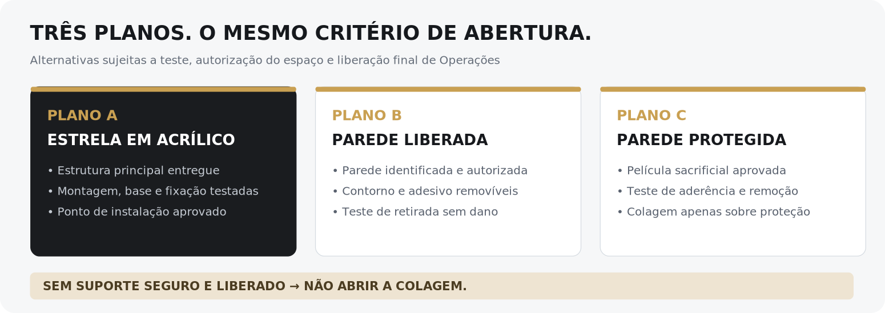
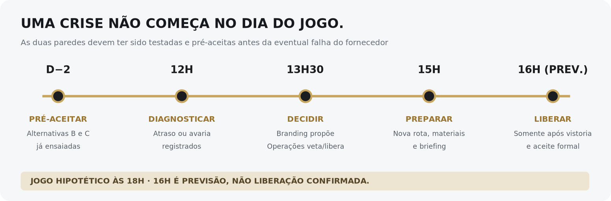

# Quando mudar de plano — ou não abrir?

Se a estrela não chegar a tempo, a prioridade não é substituí-la a qualquer custo. Branding verifica as alternativas preparadas e Operações escolhe a que pode ser montada com segurança. Se nenhuma for viável, a colagem não abre.

## Três planos, um critério de segurança

A é a estrela de acrílico. B utiliza parede autorizada, contorno e fixação removível. C utiliza parede autorizada com película protetora antes da colagem. A escolha depende dos ensaios e do aceite de Operações.

| Alternativa | Condição indispensável antes da abertura | Evidência a registrar |
|---|---|---|
| A · Estrela em acrílico | Estrutura entregue, montada e estável no ponto aprovado | Inspeção de montagem, estabilidade, bordas, base, fixação e circulação |
| B · Parede liberada | Parede identificada e autorizada; adesivo e contorno testados sem dano | Registro da superfície, teste de aplicação/remoção e aceite de Operações |
| C · Parede protegida | Local autorizado; película compatível, íntegra e testada | Teste de fixação/retirada, inspeção da proteção e aceite de Operações |
| Nenhuma alternativa aprovada | Não há suporte seguro ou circulação adequada | A colagem não abre; comunicar a decisão e não convocar o público para o ponto |

As duas soluções de parede são distintas: uma depende de adesivo removível aplicado à superfície; a outra, de película protetora. Cada uma precisa de ensaio de remoção e de avaliação do ponto concreto, e não apenas de disponibilidade de uma parede.

## Cronologia de decisão

Para a partida hipotética das 18h, o plano trabalha com portões às 16h. O Botafogo já usou duas horas de antecedência em partidas de 2026, como [Bangu](https://botafogo.com.br/noticias/ingressos-botafogo-x-bangu-ftr) e [Palmeiras](https://botafogo.com.br/noticias/ingressos-botafogo-x-palmeiras-br26), mas também abriu três horas antes contra o [Fluminense](https://botafogo.com.br/noticias/ingressos-botafogo-x-fluminense-br26). O horário da partida-alvo prevalece após confirmação por Operações.

| Marco | Decisão ou evidência exigida |
|---|---|
| D−2 | Pré-aceite técnico de B e C, com local, ensaio e responsáveis |
| 12h | Registrar atraso/avaria do fornecedor e disponibilidade dos planos |
| 13h30 | Branding recomenda; Operações autoriza ou veta |
| 15h | Instalação alternativa, sinalização e fluxo inspecionados |
| 16h (prev.) | GO/NO-GO após liberação definitiva de Operações |

Os horários guiam a decisão. O ensaio precisa demonstrar que existe tempo para mudar a instalação, corrigir a orientação ao público e vistoriar o ponto antes da abertura real.

## Decisão e comunicação

Branding registra o desvio e recomenda a alternativa. Operações decide sobre montagem, circulação e abertura. Futebol é informado de mudanças que afetem acessos do elenco; Comunicação atualiza orientação ao público e conteúdo; Comercial/Jurídico tratam obrigações do fornecedor.

A liberação exige instalação estável, material removível testado, rotas livres, acessibilidade e orientação da equipe. Se nenhuma alternativa cumprir esses critérios, encerra-se a colagem, sem convocar público ao ponto.

## Evidências específicas do plano alternativo

Para B e C, registrar fotos e localização da parede, permissão de uso, teste de adesão/remoção, integridade da película quando adotada e vistoria de circulação. A equipe deve ensaiar a troca de sinalização e o deslocamento da fotografia até o ponto escolhido. As responsabilidades e os prazos de produção constam do README 05.

Referências de análise: [NT 5-01](https://www.cbmerj.rj.gov.br/wp-content/uploads/2022/04/NT-5-01-Centros-esportivos-de-eventos-e-de-exibicao.pdf) e [NT 5-04](https://www.cbmerj.rj.gov.br/wp-content/uploads/2022/04/NT_5-04_alterada_pela_Portaria_1167_2022_1644255940_2022-02-07.pdf) do CBMERJ, conforme o enquadramento da instalação e a avaliação técnica competente.

## Previsão contratual

O escopo de cenografia deve fixar entrega, montagem, vistoria, correção e procedimento de comunicação do atraso. Reembolso, substituição, penalidades e seguro dependem de negociação contratual. O orçamento já reserva verba de contingência, detalhada no README 06.

Registro de campo: motivo do desvio, alternativa adotada, responsável pelo aceite e decisão GO/NO-GO.

[PDF deste README](README.pdf) · [Slide](assets/slide_08.png)
